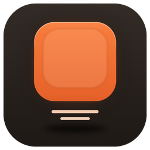

# Claude Controller

An unofficial Logi Actions SDK plugin that brings live [Claude Code](https://claude.com/claude-code) sessions –
in the Claude desktop app (Code tab) and in the terminal – to the **Logitech MX Creative Keypad** (macOS).

> Unofficial community plugin. Not affiliated with or endorsed by Anthropic or Logitech.
> "Claude" and "Claude Code" are trademarks of Anthropic, PBC.

## Features

- **Up to 16 session slots** – one live tile per session, with a status pill
  (Thinking, Permission, Choose, Background, Complete, Stopped, Error, Idle). The tile breathes in orange while
  Claude works and in blue while only subagents or background commands are still running.
  Pressing a slot opens a folder with that session's details and controls.
- **Open Session** – the status key in the folder opens exactly this session in the Claude desktop app.
- **Allow Once / Allow in Session / Always Allow / Deny** – answer permission requests from the keypad.
  The dialog in Claude stays as it is: whoever answers first wins.
- **Stop** – stops a running session (a waiting request is denied and the turn is interrupted).
- **Next Waiting Session** – lights up when a session waits for you; press to jump to it.
- **Usage limits** – usage ring and reset countdown for the 5-hour limit, the weekly limit, the weekly limit of a
  single model (when your plan has one) and extra usage.
- **Context** and **Tokens** – the exact context size of the last request and the token counts of a session.
- **New Code Session**, **New Chat / Cowork Task** and **Open Claude**.
- **Clear Finished**, **Refresh**, **Slot Order** (sticky, most recent activity, or most recent status change).
- **Claude Hooks On/Off** – removes everything the plugin added to Claude Code's settings, or adds it again.

## Requirements

- macOS
- Logi Options+ with the Logi Plugin Service (version 6.0 or later)
- Logitech MX Creative Keypad
- The Claude desktop app and/or Claude Code in the terminal
- For the usage limits: Claude Code signed in with a Claude subscription (Pro or Max)

## How it works

Live status comes from [Claude Code hooks](https://code.claude.com/docs/en/hooks). When the plugin starts, it adds
its hooks to `~/.claude/settings.json`:

- Each hook posts the event to the plugin on `127.0.0.1:47821` (your Mac only). If the plugin is not running, the
  hook gives up after half a second and Claude Code carries on as usual.
- The plugin only adds and removes its own entries (marked `client=claude-controller`). Everything else in the
  file stays untouched. A backup of the file is kept at `~/.claude/settings.json.claude-controller.bak`.
- Your statusline keeps working: the plugin runs it through a small bridge script that also passes the rate limits
  to the plugin. Your original statusline command is saved and restored when the hooks are removed.

Session titles and the links to open a session come from the desktop app's local session files; tokens and
context come from Claude Code's local transcripts.

### Removing the plugin

Logi Options+ does not tell a plugin when it is uninstalled. **Before uninstalling, press "Claude Hooks On/Off"**
to switch the hooks off. This restores your `settings.json` and statusline.

If the plugin is already gone, remove the hooks by hand: delete every hook in `~/.claude/settings.json` whose
command contains `client=claude-controller`, and set `statusLine` back to the value saved in
`~/Library/Application Support/ClaudeController/statusline-original.json`. The folder
`~/Library/Application Support/ClaudeController/` can then be deleted.

## Permissions

- **Keychain** – for the usage limits the plugin reads Claude Code's sign-in (`Claude Code-credentials`) with
  macOS's own `security` tool. If macOS asks, allow it. Without it everything else works; the limits then only
  update from terminal sessions.
- **Accessibility** – only needed when you press Stop while a desktop session is writing text without using a
  tool. The plugin then sends Esc to the Claude app. macOS asks once:
  *System Settings → Privacy & Security → Accessibility → enable "Logi Plugin Service"*.

## Privacy

The plugin has exactly one network connection: every few minutes (and when you press a limit key) it asks
`api.anthropic.com` for **your own usage limits**, using the Claude sign-in already on your Mac. The sign-in token
is read fresh each time, never stored, never refreshed and never sent anywhere else.

Everything else stays on your Mac. The plugin keeps a small cache in
`~/Library/Application Support/ClaudeController/` (last limits, session status across restarts, and a local
event log with session titles). It collects no analytics and contains no tracking.

## Known limitations

- The usage limits come from the same endpoint the Claude desktop app uses. It is not publicly documented, so a
  change on Anthropic's side can break the limit keys until the plugin is updated.
- The desktop app keeps the size of a session's context window to itself. The context key therefore shows the
  exact token count, and the ring only for terminal sessions, where Claude Code reports the window size.
- Pressing the slot of a terminal session brings the terminal app to the front.
- Only sessions running on this Mac get slots (no cloud sessions).

## Support

Found a bug or have a question? [Open an issue](https://github.com/DannyYoung21/logi-claude-plugin/issues)
or write to **dannylabs.studio@gmail.com**.

Please include your macOS version, the Claude app or Claude Code version, and what you pressed and expected.

## Building from source

Requires the .NET SDK and Logi Options+ (the build references `PluginApi.dll` from the Logi Plugin Service).

```bash
dotnet build -c Release src
logiplugintool pack bin/Release ClaudeController_1_0_3.lplug4
logiplugintool verify ClaudeController_1_0_3.lplug4
```

A Debug build registers the plugin with the Logi Plugin Service for development.

## License

[MIT](LICENSE) © 2026 Daniele Mazzotta

Use of the plugin is also subject to the [End User License Agreement](EULA.md).
